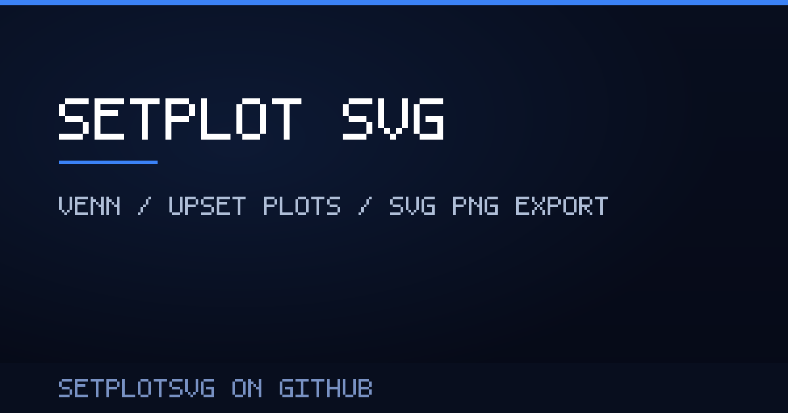

# SetPlotSVG

**SetPlotSVG** 是一个纯前端、零后端的韦恩图 / UpSet 集合绘图工具。把若干组元素列表粘贴进来，即可在浏览器里生成可交互的韦恩图或 UpSet 图，并导出 SVG / PNG。

> SetPlotSVG is a client-side Venn diagram and UpSet plot generator. All data stays in your browser; no upload, no backend.

无构建步骤、无运行时依赖，`index.html` 可以直接打开，也可以直接托管在 GitHub Pages 上。

## 在线使用

无需安装，直接打开 **[SetPlotSVG 在线工具](https://natanalysis.com/setplotsvg/)** 即可使用。



## 功能

- **样本数量不设上限**：2–4 组用经典韦恩图；5–6 组可在花瓣图 / UpSet 图之间切换；7 组以上使用 UpSet 图。
- **面积正比模式**：勾选后各区域面积按所含元素数量缩放（2 组为精确解，3–4 组为数值拟合，并在图上显示最大面积偏差）。
- **交互**：点击区域或数字查看元素；元素查找并高亮其所在区域；拖拽任意名称/数字调整位置，双击复位；数字放不下时用 `?` 占位，悬停显示真实值。
- **样式**：填充模式、线宽、字体与字号、文字/描边/填充配色、透明度、紧凑/宽松布局、深色模式。
- **导出**：SVG；PNG（640 / 1024 / 2048 / 4096 像素宽，可选透明背景）；区域统计 CSV。
- **导入**：拖拽 `.txt` / `.csv` 到列表框，CSV 每列拆成一个列表，元素自动去重排序。
- **分享链接**：把当前输入与设置压缩进 URL hash，复制即分享。
- **其他**：撤销 / 重做、自动保存到 localStorage、中英文界面切换、实验分组与配色（UpSet 右侧显示分组）。

## 快速开始

直接双击 `index.html` 即可使用。

需要本地 HTTP 环境时（例如测试分享链接）：

```bash
npm install        # 仅测试需要 jsdom
npm run serve      # http://127.0.0.1:8080/
```

## 使用

1. 在左侧卡片粘贴元素列表，每行一个；点 **Add sample** 增加列表。
2. 点击图中数字或区域，左侧 Results 面板列出该区域元素；**Export CSV** 导出全部区域。
3. 勾选 **Area-proportional** 切换到面积正比模式。
4. 选择填充、线宽、字体等样式后，用 **SVG / PNG** 一键导出。
5. **Copy share link** 生成包含输入与设置的分享链接。

## 部署到 GitHub Pages

仓库内所有资源均为相对路径，不需要构建：

1. 把仓库推送到 GitHub。
2. Settings → Pages → **Deploy from a branch** → 选择 `main` 分支和 `/ (root)`。
3. 稍等片刻，访问 `https://<用户名>.github.io/<仓库名>/`。

可选：上线后把 `index.html` 中的 `og:image` / `twitter:image` 改成部署后的绝对 URL，部分社交平台才能正确抓取分享图。

## 项目结构

```
index.html                 页面（唯一入口）
setplotsvg.js              全部交互与绘图逻辑
setplotsvg.css             样式（含深色模式）
logo.svg                   图标
og-image.png               社交分享图（由 tools/make-og.mjs 生成）
vendor/
  polygon-clipping.min.js  区域布尔运算（第三方，MIT）
tests/                     jsdom 回归测试
tools/
  serve.mjs                零依赖本地静态服务器
  test.mjs                 测试汇总入口
  make-og.mjs              重新生成 og-image.png
```

## 测试

```bash
npm install
npm test
```

测试基于 jsdom，覆盖区域多边形生成、输入/渲染/点击、面积正比、拖拽、配色、查找、UpSet、5–6 组、分组、任意样本数与导出等行为。

推送到 GitHub 后，`.github/workflows/test.yml` 会在 Node.js 20 / 22 上自动执行 `npm ci` + `npm test`。

## 浏览器支持

最新版 Chrome、Edge、Firefox、Safari。需要 ES5+、SVG 与 Canvas；PNG 导出依赖 Canvas `toBlob`。

## 致谢

- **Venny 2.1** — Oliveros, J.C. (2007–2015), BioinfoGP, CNB-CSIC；本工具的交互与配色参考并兼容 Venny。
- **jvenn** — Bardou et al., *BMC Bioinformatics* 2014, 15:293；元素查找、`?` 占位、统计小图等交互借鉴自 jvenn。
- [polygon-clipping](https://github.com/mfogel/polygon-clipping)（MIT，内含 splaytree）— 区域布尔运算。
- [UpSet](https://upset.app/) — 多集合交集可视化的思路来源。

`index.html` 页脚中的 Venny 来源声明请保留。

## 许可证

[MIT](LICENSE)